# 清掃業のシステム　操作マニュアル

## 1. このシステムでできること

清掃会社の仕事を、**依頼から請求まで1か所で**扱うシステムです。依頼の記録、見積、契約、現場の予定、写真と報告書、請求、小口現金までが、ひとつにつながっています。Excel への書き写しや、スマホの写真の探し直しが要りません。

- 依頼（案件）を、依頼元・建物・期限・担当つきで記録し、**期限切れを知らせる**
- 見積を作り、承認されたら**契約**にする。契約から**作業の予定**と**請求の下書き**ができる
- 現場の人が、スマホで**作業の開始・終了、写真、報告書**を記録する。電波がなくても記録でき、戻ったら自動で送られる
- 取引先（管理会社・オーナー）には、**専用ページ**で、進み具合と提出した報告書だけを見せる

この説明書の画面は、架空の会社「サンプル清掃株式会社（デモ）」のものです。画面に出る会社名・人・建物・金額は、すべて架空です。

### 仕事の流れ

| 順 | だれが | すること | できるもの |
|---|---|---|---|
| 1 | 事務・社員 | 依頼を**案件**として記録する | 期限と担当つきの案件 |
| 2 | 事務・社員 | **見積**を作って出し、承認を記録する | 承認された見積 |
| 3 | 事務・社員 | 承認された見積から**契約**を作る | 契約と、作業の予定 |
| 4 | 事務・社員 | **予定表**で担当のスタッフを決める | 担当つきの作業 |
| 5 | スタッフ | 現場で**開始**を押し、写真を撮り、**報告書**を作り、**終了**を押す | 実績・写真・報告書 |
| 6 | 事務・社員 | 報告書を**確認**して**提出**する | 取引先が読める報告書 |
| 7 | 事務・社員 | 月ごとに**請求書**を作り、発行・送付・入金を記録する | 請求書と入金の記録 |

### 自分が読む章

| 役割 | だれ | 読む章 |
|---|---|---|
| スタッフ | 現場の人（パートを含む） | 2・3・**4**・8 |
| 社員 | 事務・営業 | 2・3・**5**・8 |
| 管理者 | 社長・事務の責任者 | 2・3・5・**6**・8 |
| 外部 | 管理会社・オーナーの担当者 | 2・**7** |

> **覚えておくこと**　見える画面と、できる操作は、役割で決まっています。スタッフには金額と見積は見えません。外部の人は、専用ページだけを見られます。見えない画面があるのは、故障ではありません。

## 2. 始める前に

### 2-1. ログインする

このシステムは、**パスワードを使いません**。登録したメールアドレスに、ログインのリンクが届きます。

1. ブラウザで、会社から案内された URL を開く
2. 「メールアドレス」に、登録したメールアドレスを入れる
3. 「ログインのリンクを送る」を押す
4. 届いたメールのリンクを開く。ホームの画面が開けば、ログインできています

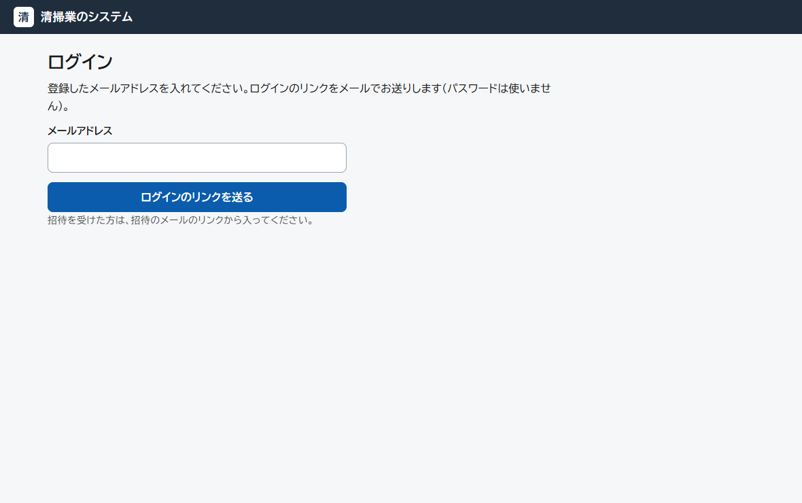

> **ポイント**　ログインのリンクは、メールを送った端末でなくても開けます。スマホで受け取ったメールのリンクを、パソコンで開いても構いません。

### 2-2. 招待を受ける

はじめて使うときは、管理者から**招待のメール**が届きます。

1. 招待のメールのリンクを開く（リンクは、送られてから**7日間・1回だけ**使えます）
2. 画面の案内に従って、「所属する」を押す
3. ホームの画面が開く。次回からは、2-1 のログインで入る

> **注意**　招待のメールが見つからないときは、迷惑メールのフォルダを探してください。期限が切れたときは、管理者に、もう一度招待してもらいます。

### 2-3. スマホのホーム画面に入れる

スマホでは、ホーム画面に入れておくと、アプリのように1回で開けます。ブラウザのメニューの「ホーム画面に追加」を選びます（手順は機種によって少し違います）。

### 2-4. 通知を入れる

予定の変更や、明日の作業などを、画面を開いていなくても知らせます。

1. ホームの案内から「お知らせの受け取り」を開く
2. 「通知を入れる」を押す
3. ブラウザが許可を聞いてきたら、「許可」を選ぶ
4. 種類ごとに、通知とメールのどちらで受け取るかを選ぶ

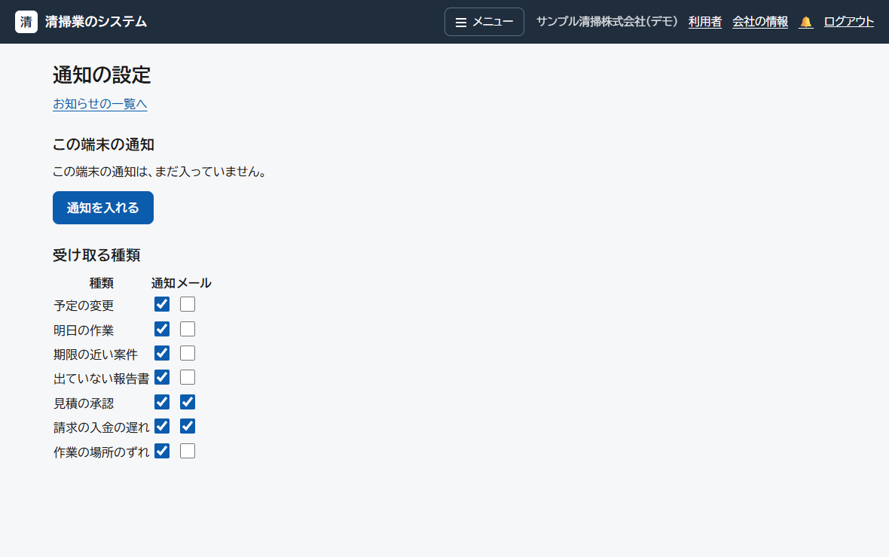

## 3. 基本の操作

### 3-1. ホームと、メニュー

ログインすると、**ホーム**が開きます。ホームには、**今日の作業**と、**期限切れの案件の数**が出ます。その下に、仕事の場所ごとに分けた案内があります（現場・営業と請求・登録・お知らせ・管理）。

どの画面からでも、画面の上の「**メニュー**」を押すと、同じ案内が開きます。

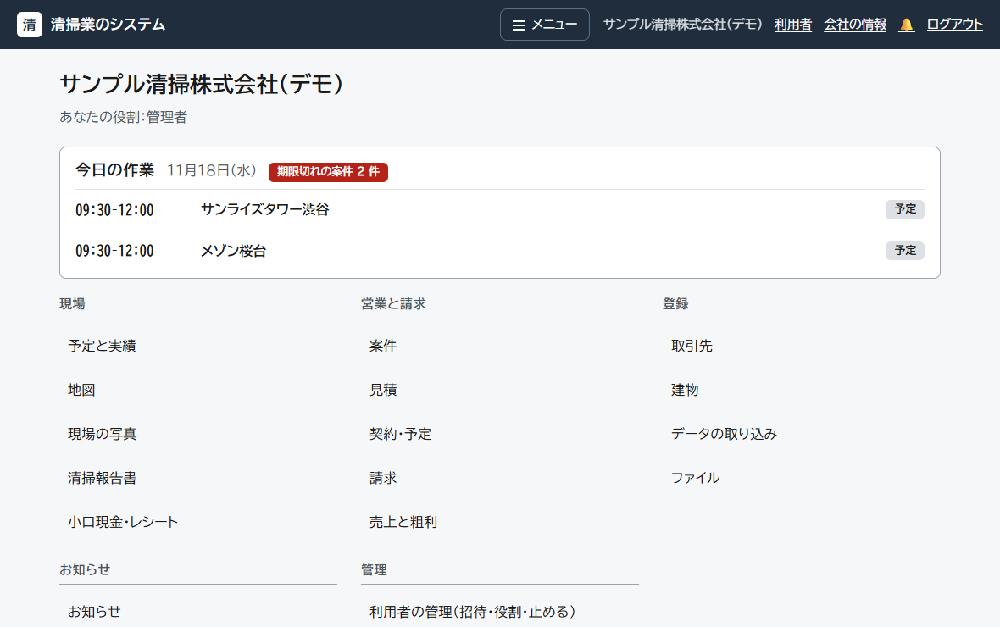

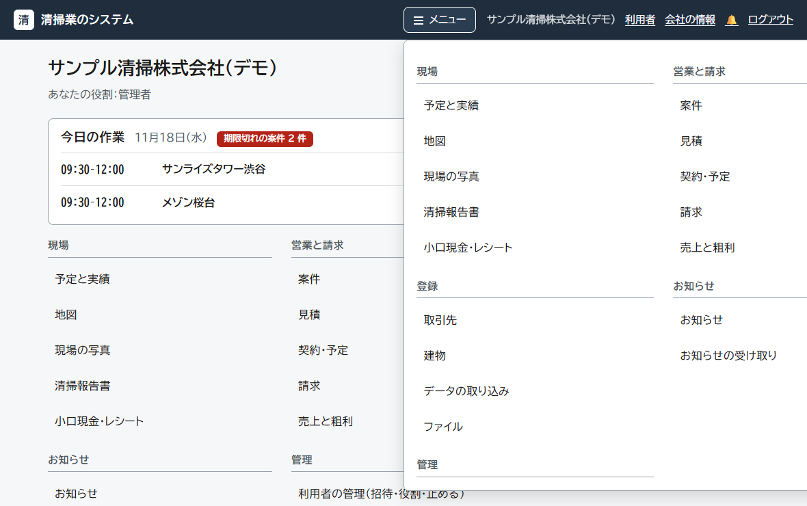

### 3-2. 札の色の意味

一覧に出る小さな札は、色にも意味があります。文字も付いているので、色が見分けにくくても読めます。

| 色 | 意味 | 例 |
|---|---|---|
| 青 | 進めてよい操作、提出済み | 「提出」の見積 |
| 黄 | 注意、期限が近い、作業中 | 「今日が期限」「作業中」 |
| 赤 | 期限切れ、取り消し | 「期限切れ（3日過ぎ）」 |
| 緑 | 完了 | 「承認」「完了」「入金済み」 |

### 3-3. 保存・取り消し・削除

- 入力したあとは、画面のボタン（「保存する」「登録する」など）を押して確定します。押すまでは、記録されません
- 消した情報は、画面から見えなくなりますが、**記録としては残ります**（あとから経緯を調べられます）
- **提出した見積、発行した請求書、確認した小口は、直せません**。直すときは、「直した版を作る」「取り消す」など、画面に用意された操作を使います

### 3-4. 電波がないとき

現場の記録（開始・終了、写真、報告書、小口）は、**電波がなくても操作できます**。記録は、いったんスマホの中にたまり、電波が戻ると**自動で送られます**。

- 画面の上の方に、**送れていない件数**が出ます。件数が0になれば、すべて送れています
- 送れていないうちは、**ブラウザを閉じても、記録は消えません**
- 同じ記録を二度送っても、**1件にまとまります**（二重にはなりません）
- 写真の画面の「今すぐ送る」で、送り直せます

## 4. スタッフ編：現場の1日

ここは、現場のスタッフが**スマホで**使う手順です。1日の流れの順に並べています。

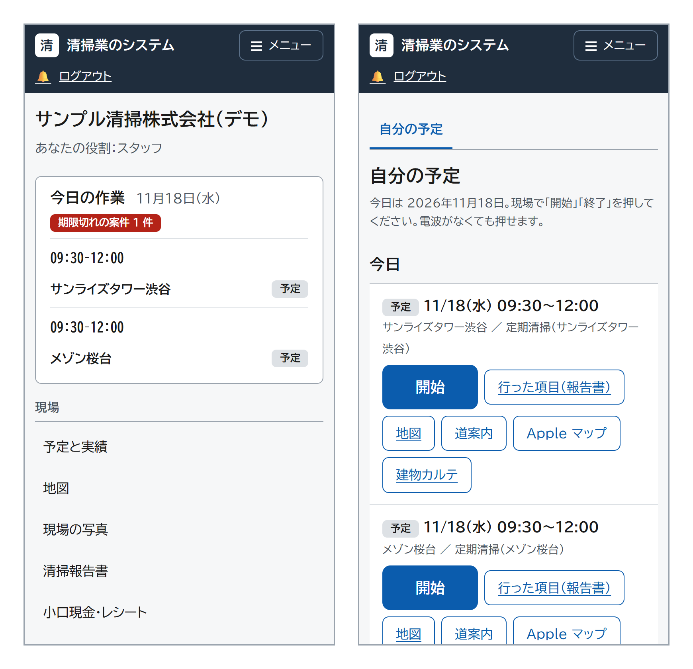

### 4-1. 今日の予定を見る

1. ログインして、ホームを開く。「**今日の作業**」に、今日の作業が時刻順に出る
2. 詳しく見るときは、「予定と実績」を開き、「**自分の予定**」を押す
3. 「今日」に今日の作業、「これから」に先の作業が出る。建物名・時刻・作業の名前を確かめる

> **覚えておくこと**　スタッフに見えるのは、**自分が担当の作業**だけです。担当になっていない作業は出ません。出ているはずの作業がないときは、事務に、担当に入れてもらってください。

### 4-2. 現場へ向かう

作業ごとに、現場へ行くための3つのボタンがあります。

| ボタン | 使うとき |
|---|---|
| 地図 | アプリの中の地図で、建物の場所を見る |
| 道案内 | スマホの地図アプリを開いて、道案内を始める |
| 建物カルテ | 入り方・鍵の場所・駐車場・ゴミの日・管理人の連絡先・注意すること、を読む |

> **ポイント**　はじめての現場は、出発の前に「建物カルテ」を読んでください。鍵の場所や、入ってはいけない時間帯が書いてあります。

### 4-3. 作業を始める

1. 現場に着いたら、「自分の予定」の、その作業の「**開始**」を押す
2. 位置の記録の了承を聞かれたら、内容を読んで、了承するかを選ぶ
3. 作業の表示が「作業中」に変わる

> **覚えておくこと**　位置を記録するのは、**開始と終了を押したときだけ**です。作業中に、位置を追い続けることはありません。記録した位置は、90日たつと自動で消えます。

### 4-4. 写真を撮る

作業の前と後、気づいたことを、写真に撮ります。

1. 「現場の写真」の「**撮る**」を開く（報告書の画面からも撮れます）
2. 「建物」を選ぶ
3. 「種類」を選ぶ（作業前・作業後・気づき）
4. 場所・部屋を選ぶ（選ばなくてもよい）
5. 「写真を撮る」を押して、カメラで撮る

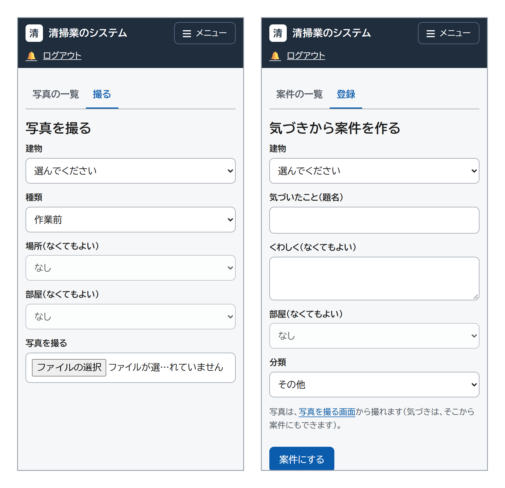

> **ポイント**　写真は、縮小して保存されます。撮った場所の位置情報は、スマホの中で消してから送られます。

### 4-5. 清掃報告書を作る

作業ごとに、報告書を作ります。作業の担当者は、だれでも書けます（同じ作業の担当が2人いるときは、**同じ報告書を一緒に作ります**）。

1. 「自分の予定」で、その作業の「**行った項目（報告書）**」を押す
2. 行った項目の**チェックを入れる**。各項目に、メモも書ける（書かなくてもよい）
3. 項目ごとの「作業前を撮る」「作業後を撮る」で、写真を撮る
4. 最後に、全体のメモを書く
5. 「**保存して送る**」を押す

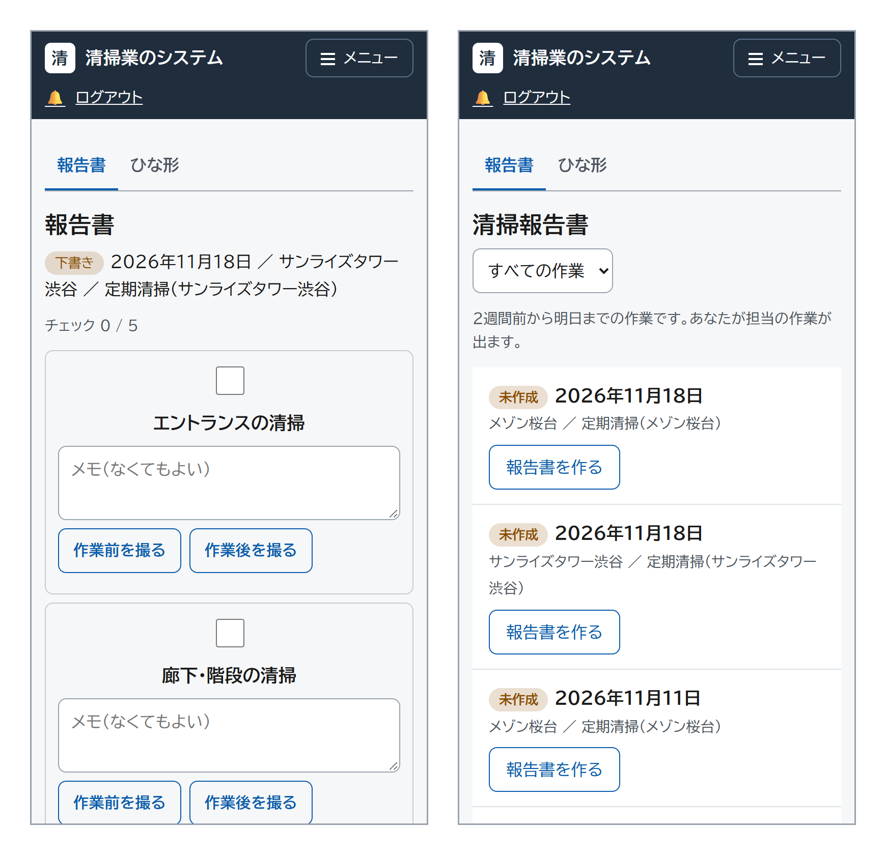

> **注意**　報告書を書き直せるのは、**下書きの間だけ**です。社員が「確認」をしたあとは、スタッフは直せません。直したいときは、事務に「下書きに戻して」と頼みます。

### 4-6. 作業を終える

1. すべて終わったら、「自分の予定」の「**終了**」を押す
2. 作業の表示が「完了」に変わる

> **ポイント**　終了を押し忘れても、事務が時刻を直せます。気づいたら、事務に連絡してください。

### 4-7. 気づいたことを案件にする

「共用部の電球が切れている」「手すりがぐらつく」など、定期の清掃とは別に対応が要ることを見つけたら、**案件**にして事務に渡します。

1. 「案件」の「登録」を開く（写真の「気づき」から開くこともできる）
2. 「建物」を選ぶ
3. 「気づいたこと（題名）」を入れる。くわしくは、「くわしく」に書く
4. 分類を選ぶ（清掃・修理・苦情・問い合わせ・その他）
5. 「**案件にする**」を押す

### 4-8. 小口現金とレシート

会社から渡された小口現金の、使った分を記録します。

1. 「小口現金・レシート」を開く。自分の小口の**残高**が出る
2. 「出金を登録」に、日付・金額・用途を入れる
3. 「レシートの写真」で、レシートを撮る
4. 「**登録する**」を押す

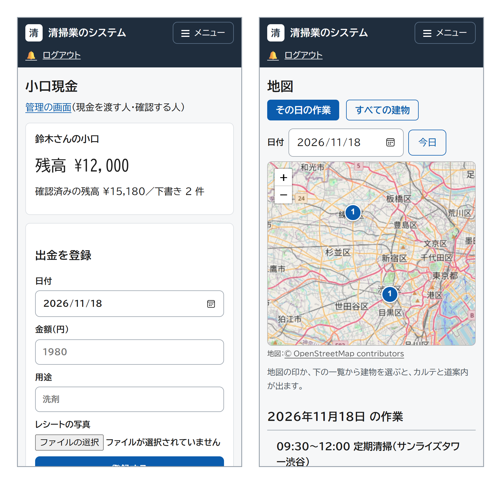

- 登録した出金は、まず**下書き**です。事務が確認すると、確認済みになります
- 下書きのうちは、「取り消す」で取り消せます。**確認のあとは直せません**
- 現金を渡されたとき（入金）は、事務が記録します

## 5. 事務・社員編：依頼から請求まで

ここは、事務・営業の人が**パソコンで**使う手順です。仕事の順に並べています。

### 5-1. 依頼を案件として記録する

電話やメールで受けた依頼を、案件にします。

1. メニューから「案件」を開き、「登録」を押す
2. 「建物」と「依頼元（取引先）」を選ぶ
3. 「題名」と「内容」を入れる
4. 「期限」「担当」「分類」「受けた方法」を決める。金額が決まっているときは、「金額」も入れる（あとからでもよい）
5. 「登録する」を押す

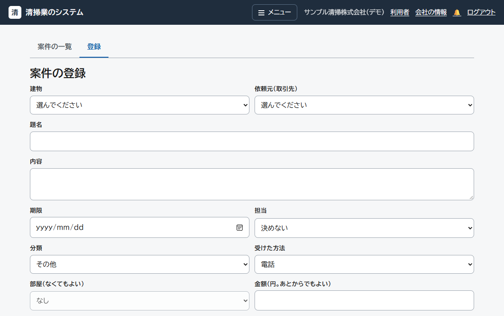

### 5-2. 案件の一覧と、期限の警告

1. 「案件」の「案件の一覧」を開く
2. 一覧の上に、**期限切れ**と**期限が近い**案件の数が出る
3. 「状況」「期限」「建物」「担当」で、絞り込める。標準では、「終わっていない（受付・対応中）」だけが出る

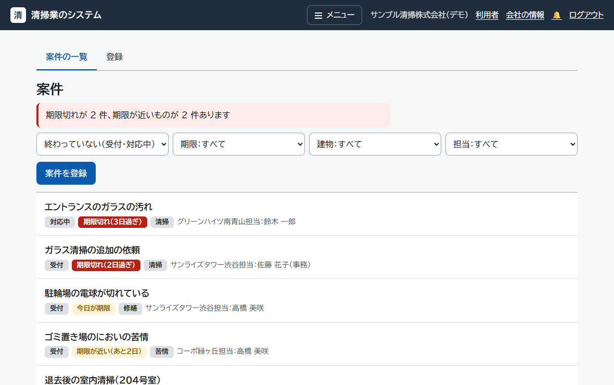

### 5-3. 案件を進める

1. 一覧で案件を選び、詳細を開く
2. 上のボタンで、状況を切り替える（「受付にする」「対応中にする」「完了にする」「取消にする」）
3. 内容・期限・担当を直したときは、「保存する」を押す
4. 金額は、「金額を保存する」で入れる（権限のある人だけに見えます）

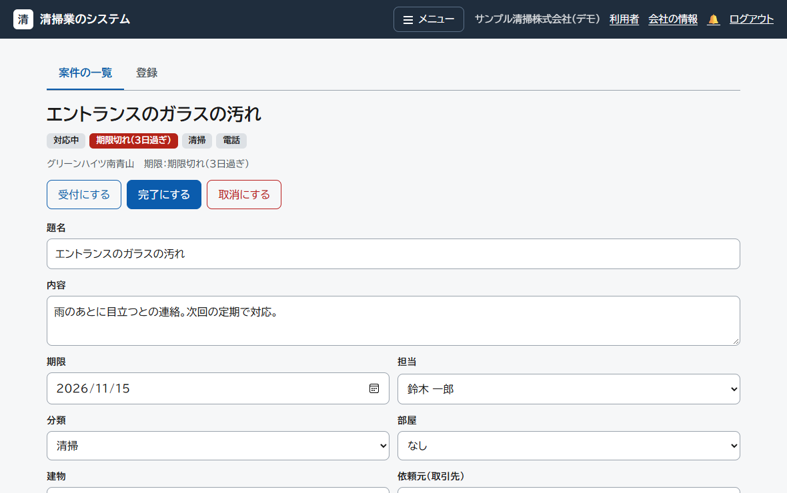

### 5-4. 見積を作る

1. 「見積」を開き、「見積を作る」を押す
2. 取引先と建物を選ぶ。案件の見積のときは、案件を選ぶ
3. 「明細を追加」で、品名の候補から明細を入れる。数量と単価を確かめる。合計と税は、自動で出る
4. 定期の見積は、**基本の月額**と**オプション**（ガラス清掃など）に分けて入れる。オプションには、行う頻度も入れる
5. 「保存する」を押す。下書きのうちは、何度でも直せる

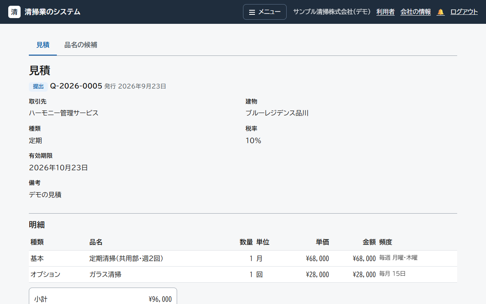

> **注意**　見積を「**提出する**」と、**直せなくなります**（番号と日付が付きます）。提出の前に、取引先・建物・金額を確かめてください。直すときは、「直した版を作る」で、元を残したまま新しい見積を作ります。

### 5-5. 見積を提出し、結果を記録する

1. 見積の画面で「**提出する**」を押す。印刷するときは「印刷（見積書）」で、A4の見積書が開く（PDF に保存もできます）
2. 取引先から返事をもらったら、「**承認で記録する**」か「**不成立で記録する**」を押す
3. 不成立のときは、理由も書く

> **ポイント**　品名と単価は、「見積」の「**品名の候補**」で登録しておくと、毎回入れ直さずに済みます。

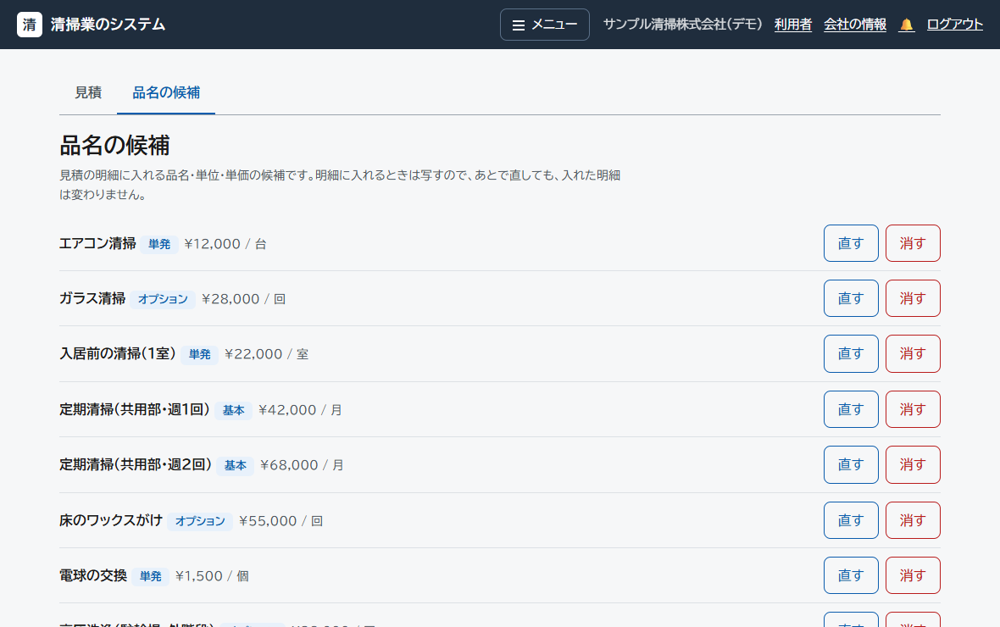

### 5-6. 契約にする

承認された見積から、**清掃の契約**を作ります。

1. 承認した見積の画面で、「契約を作る」を押す（「契約」の「見積から契約を作る」からも開けます）
2. 見積を選び、**開始日**と、契約の中身（頻度・基本の月額・オプション・担当・報告のひな形）を確かめる
3. 「契約を作る」を押す

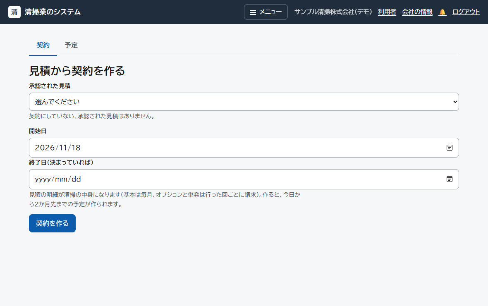

契約を作ると、頻度に合わせて、**2か月先までの作業の予定**が自動で作られます（毎週月・木、月に2回、3か月に1回、などの頻度を指定できます）。

### 5-7. 契約を変える・終える

1. 「契約」の一覧から、契約の詳細を開く
2. 金額や頻度を変えるときは、中身の「**この中身を変える**」を押す。**変えた日より先の予定が、作り直されます**。変える前の金額は、履歴として残ります
3. 契約をやめるときは、「**契約を終える**」を押す。**先の予定は取り消されます**

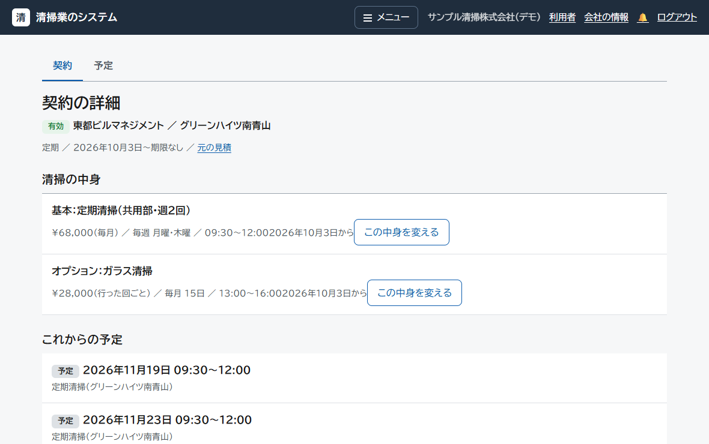

> **注意**　請求書に載った月があるときは、その月より前に終了日を決められません。終了日を、請求書に載っていない月以降にしてください。

### 5-8. 予定表で、担当を決める

1. 「予定と実績」を開き、「予定表」を押す
2. 「日」「週」「月」で、表示を切り替える。「スタッフごと」「建物ごと」でも切り替えられる
3. 同じ人の時刻が**重なっている作業**には、警告が出る。印のある作業を開いて、担当を入れ替える

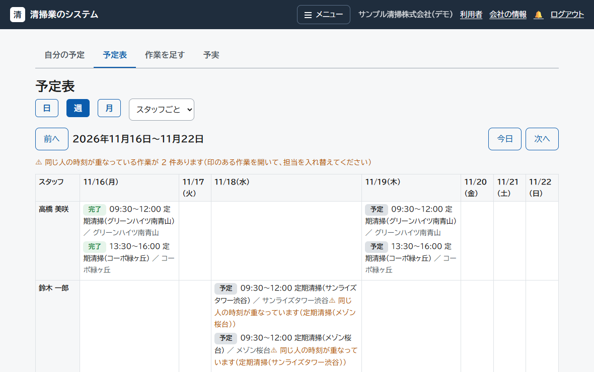

作業を開くと、次の操作ができます。

| 操作 | 内容 |
|---|---|
| 担当に付ける | 担当のスタッフを足す（重なりがあれば警告が出る） |
| 外す | 担当から外す |
| 入れ替える | いまの担当を、別のスタッフに替える |
| 日付と時刻を変える | 作業の日と時刻を変える |
| 行わず | 行かなかった作業にする（理由は残る） |
| 取消 | 作業を取り消す |

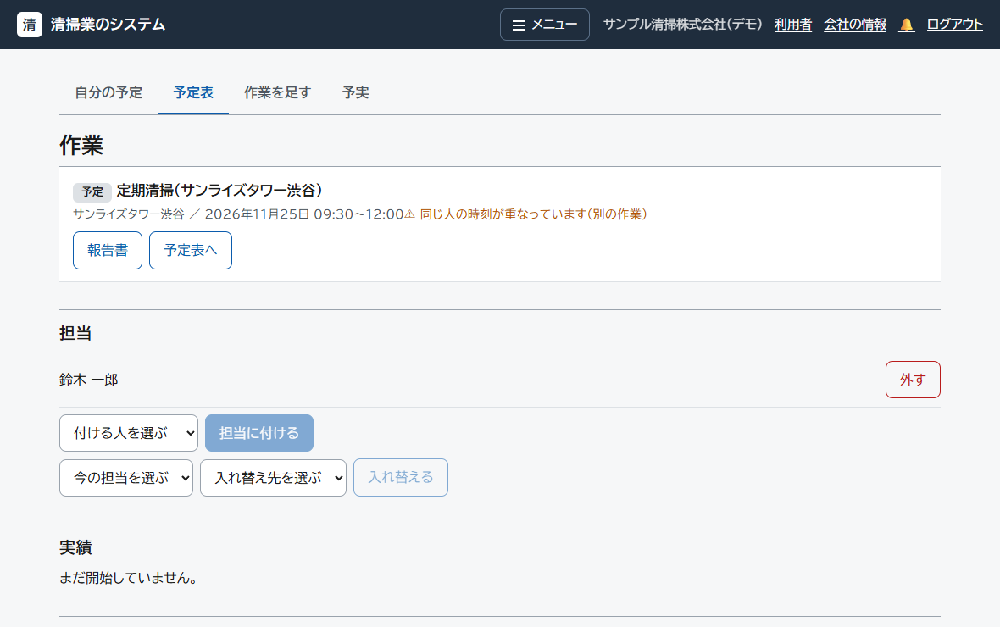

> **ポイント**　契約に決まった担当を入れておくと、予定を作るときの担当の初めの値になります。

### 5-9. 作業を足す

契約や案件に結びつく、臨時の訪問を足すときは、「作業を足す」を使います。

1. 「予定と実績」の「作業を足す」を開く
2. 元になる契約の中身か案件を選ぶ
3. 日・時刻・担当を入れ、「作業を足す」を押す

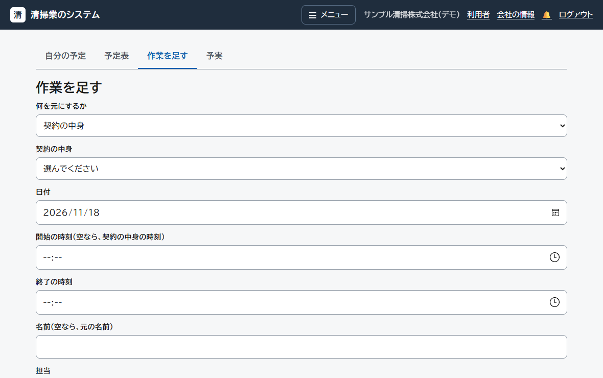

### 5-10. 予定と実績を比べる

1. 「予定と実績」の「予実」を開く
2. 期間とスタッフを選ぶ
3. **行っていない作業**、**時刻のずれ**、**行わなかった項目**、**出ていない報告書**が、一覧に出る

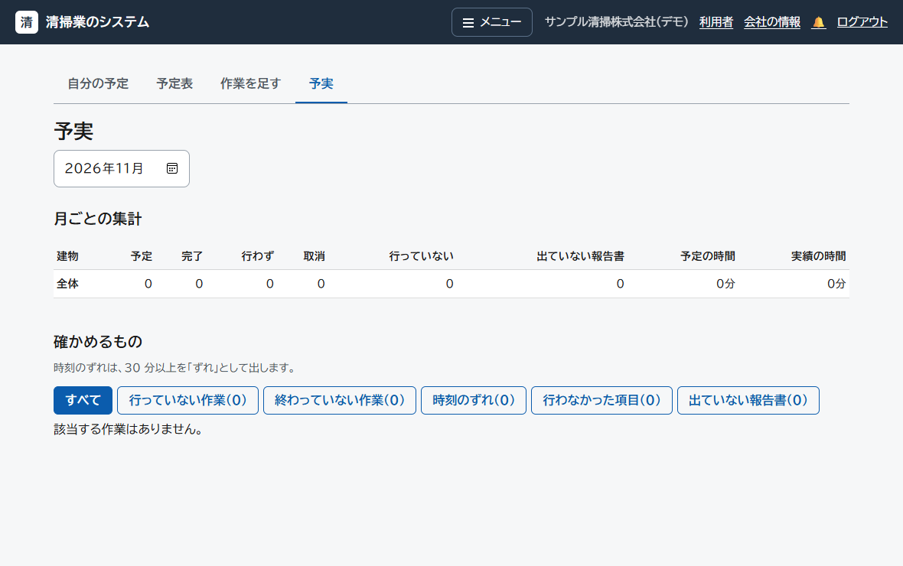

### 5-11. 報告書を確認して、提出する

1. 「清掃報告書」の一覧を開く。作業ごとに、報告書の状況（未作成・下書き・確認済み・提出）が出る
2. 下書きの報告書で「確認へ」を押し、内容（チェック・写真・メモ）を確かめる
3. よければ「**確認する**」を押す。足りないときは、「下書きに戻す」で、スタッフに直してもらう
4. 確認した報告書は、「**提出する**」を押す。**提出すると、外部の人（取引先）が読めるようになります**
5. 紙で渡すときは、「印刷」を押す（PDF に保存もできます）

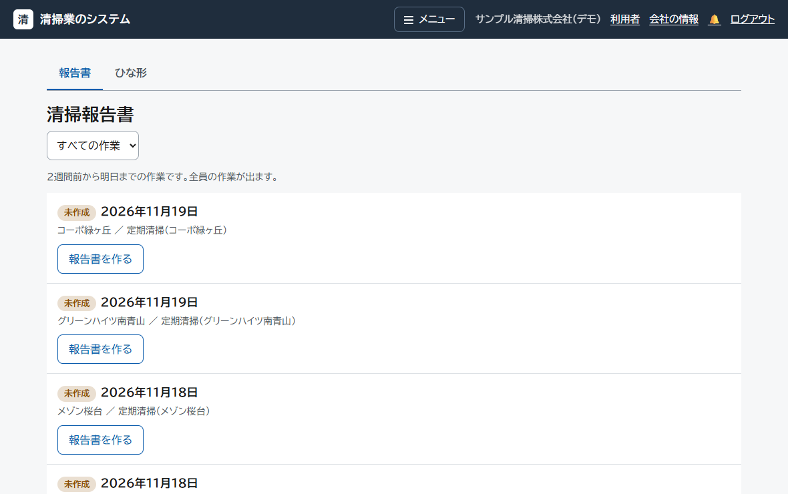

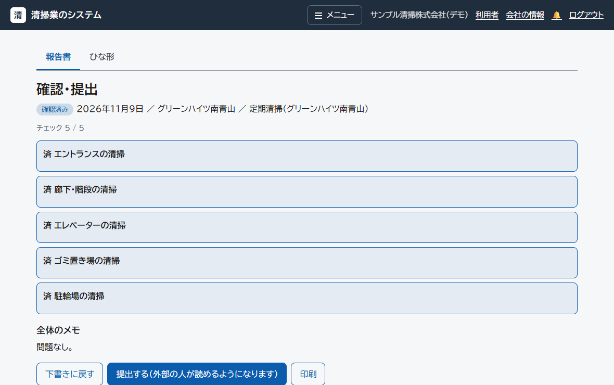

> **注意**　提出は、取引先に見せる操作です。写真と文章に、見せてはいけないもの（入居者の情報など）がないかを、提出の前に確かめてください。

### 5-12. 報告のひな形を作る

建物ごとに、報告の**項目**（エントランス・階段・ゴミ置き場など）を決めておくと、スタッフの報告書に自動で並びます。

1. 「清掃報告書」の「ひな形」を開く
2. 建物を選び、「ひな形を作る」を押す
3. 「項目を足す」で、項目を入れる。「上へ」「下へ」で並びを変える

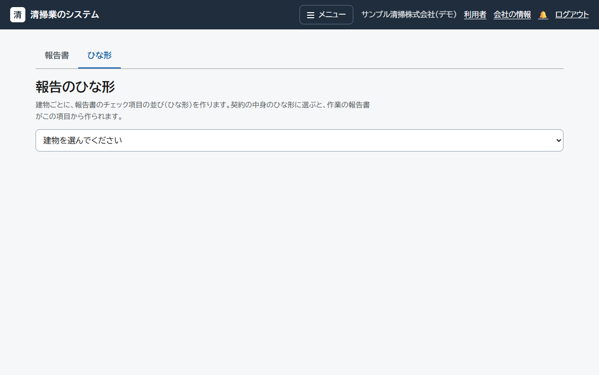

> **ポイント**　すでに使われている項目は、消さずに「使わない」にします。過去の報告書の記録は、そのまま残ります。

### 5-13. 請求書を作る

請求は、**取引先ごと・月ごとに1枚**です。

1. 「請求」を開き、「請求する月」を選ぶ。取引先を絞ってもよい
2. 「**下書きを作る**」を押す。定期の月額、その月に行ったオプション・特別清掃、終わった案件の金額が、取引先ごとにまとまる
3. 下書きを開いて、明細を確かめる。載せたくない明細は「外す」で外せる（あとから戻せる）

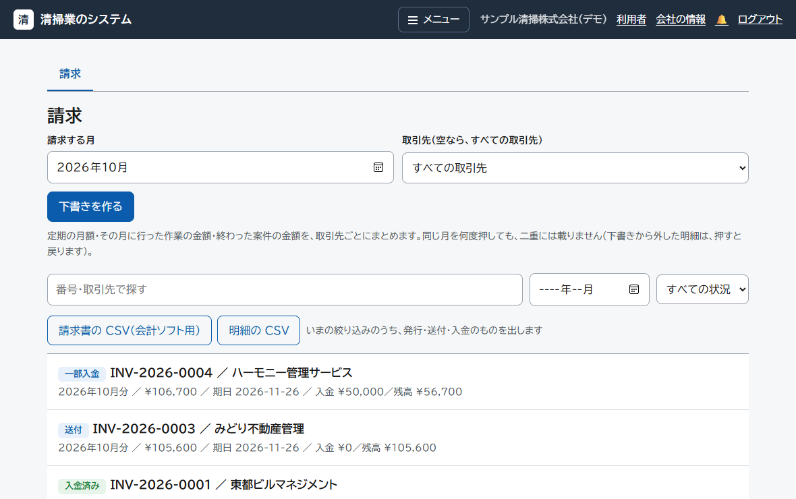

> **覚えておくこと**　同じ元（契約の月・作業・案件）は、**二重に請求されません**。下書きを作り直しても、すでに請求書に載ったものは、載りません。

### 5-14. 請求書を発行し、入金を記録する

1. 下書きを確かめ、「**発行する**」を押す。請求書の番号・税・合計が決まる（インボイスの書き方になります）
2. 取引先に送ったら、「送付を記録する」を押す
3. 入金があったら、「入金を記録する」に、入金の日と金額を入れる。**一部だけの入金**も記録できる。全額入金されると「入金済み」になる
4. 間違えて発行したときは、「取り消す」を押す（取り消したあと、同じ月の請求書を作り直せます）
5. 紙や PDF で渡すときは、「印刷（請求書）」を押す。会計ソフトに渡すときは、一覧の「請求書の CSV」を使う

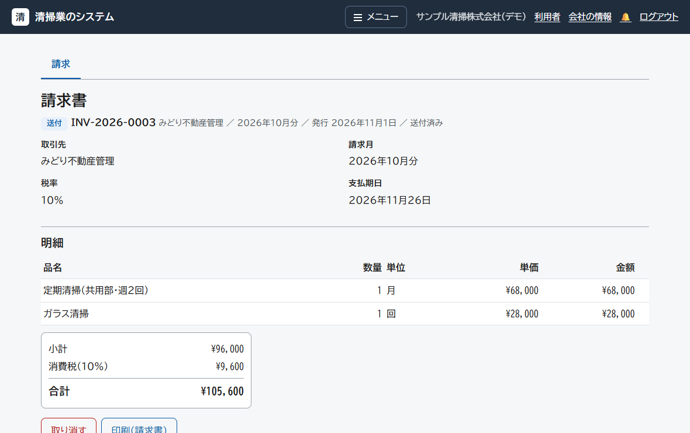

> **注意**　**発行した請求書は、直せません**。金額を間違えたときは、取り消して、作り直します。

### 5-15. 売上と粗利を見る

1. 「売上と粗利」を開き、月を選ぶ
2. 「集め方」で、建物ごと・契約ごと・取引先ごとに切り替える
3. **売上**（請求書の明細）から、**費用**（小口の支払いと、手で入れた外注・材料の費用）を引いた**粗利**が出る。前の月・前の年と比べられる

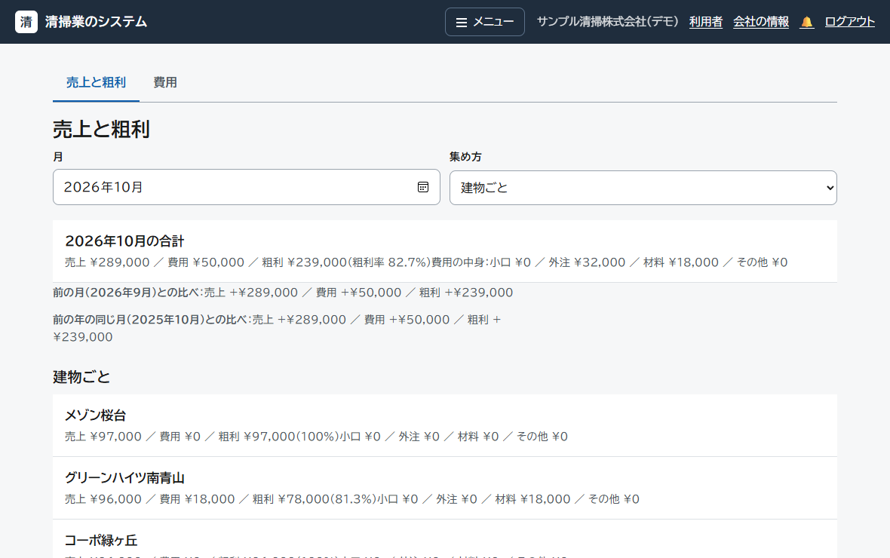

外注・材料などの費用は、「費用」で手で入れます。

1. 「売上と粗利」の「費用」を開く
2. 月・建物（または契約）・種類（外注・材料・その他）・金額を入れて、追加する

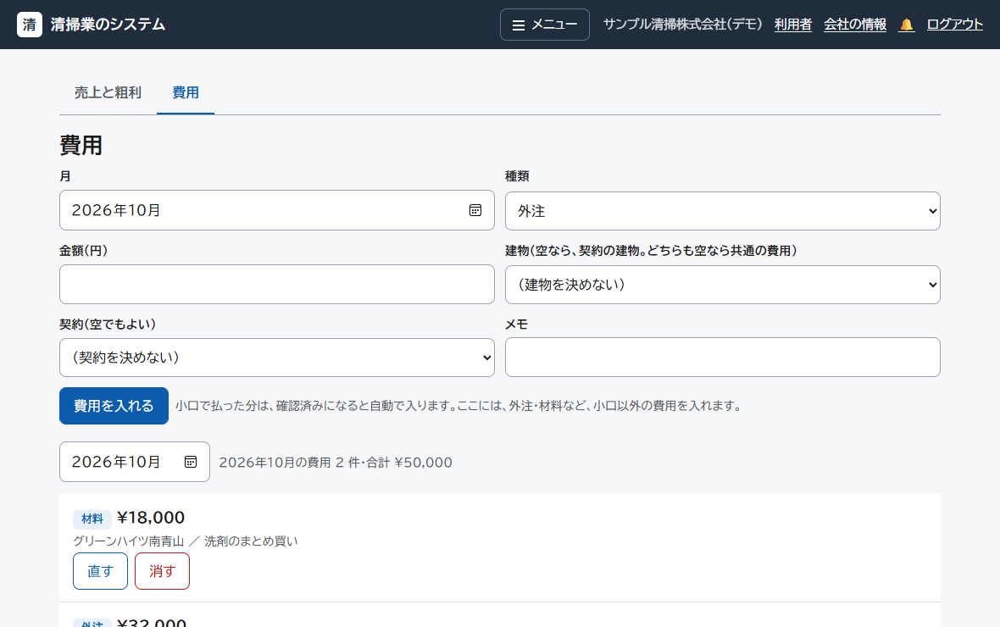

### 5-16. 小口現金を管理する

スタッフに渡した小口の出入りを、確認して、月ごとに締めます。

1. 「小口現金・レシート」の「**管理の画面**」を開く
2. 現金を渡したときは、「入金を登録する」に、渡す相手と金額を入れる
3. スタッフが登録した出金（下書き）を、レシートと見比べる。よければ「下書きをすべて選ぶ」などで選んで、確認する
4. 月の終わりに、締める
5. 会計ソフトに渡すときは、「CSV を書き出す」を押す（確認済み・締め済みだけが出ます）

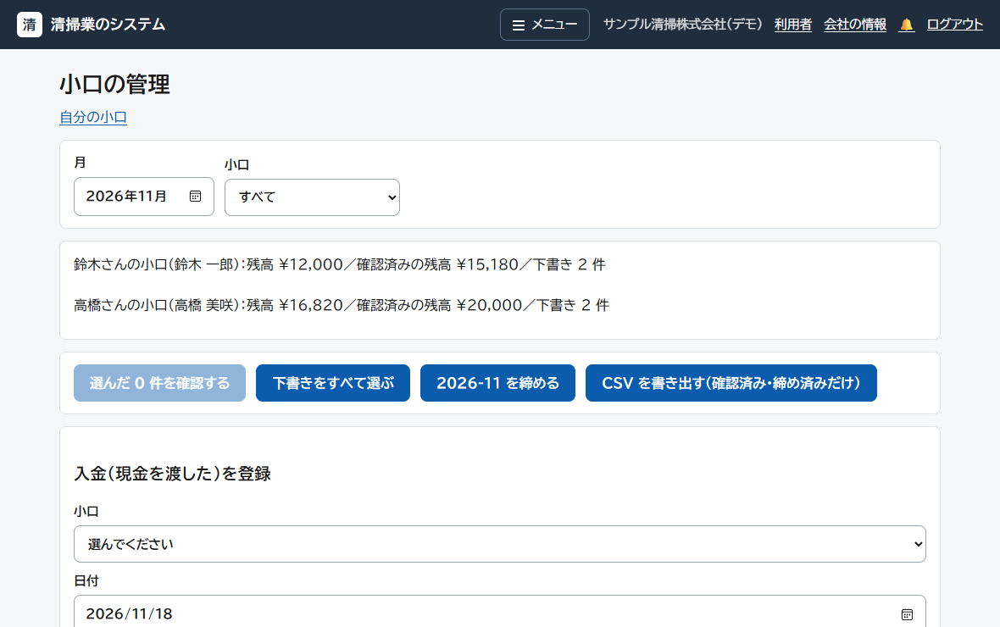

### 5-17. 取引先と建物を登録する

1. 「取引先」を開き、「新規登録」で、名前・種類（管理会社／オーナー）・住所・電話・メール・締め日・支払条件を入れる
2. 担当者は、取引先の詳細の「担当者を追加」で、名前・メール・電話を入れる
3. 「建物」を開き、「新規登録」で、依頼元と建物の名前・住所を入れる
4. 建物の詳細で、**建物カルテ**（入り方・鍵の場所・駐車場・ゴミの日・管理人の連絡先・注意すること）、部屋、場所を入れる

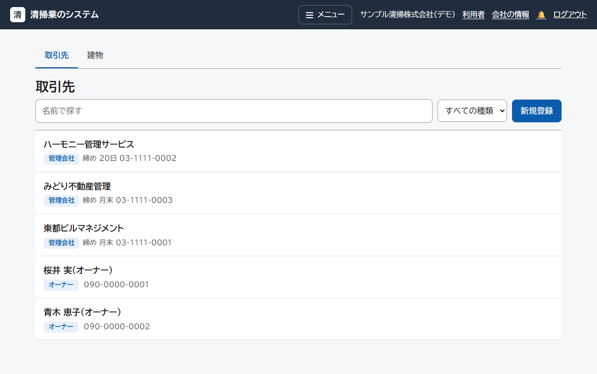

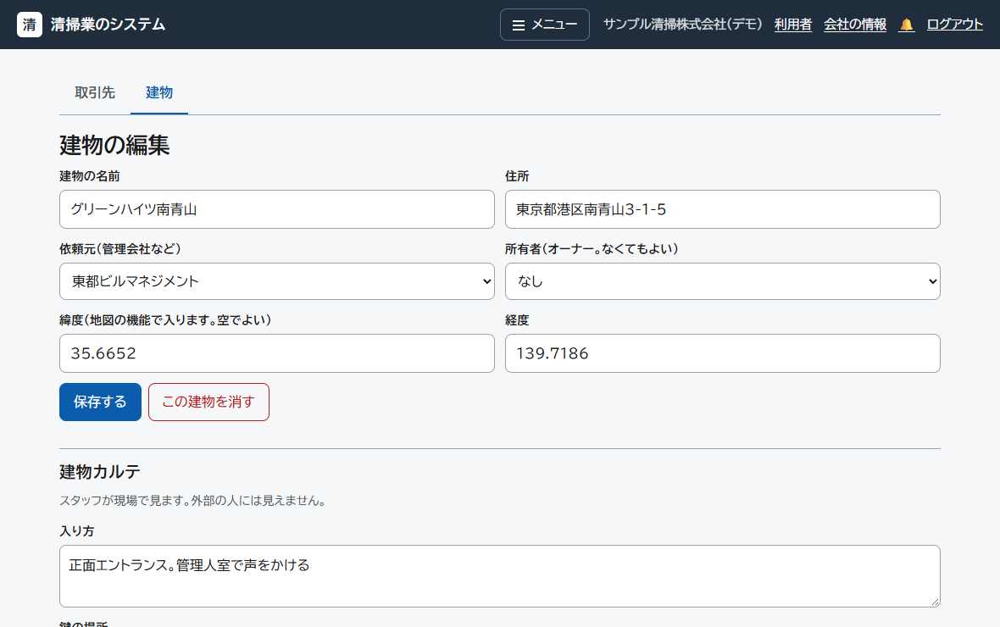

> **注意**　建物・契約・請求書が残っている取引先は、消せません。先の予定や有効な契約がある建物も、消せません。消せないときは、理由が画面に出ます。

> **ポイント**　建物カルテの「鍵の場所」「入り方」は、**外部の人には見えません**。スタッフの画面には出ます。

### 5-18. 地図で場所を確かめる

1. 「地図」を開く
2. 「その日の作業」で、日付の作業の場所が、「すべての建物」で、建物の場所が出る
3. 印を押すと、建物カルテと道案内が出る
4. 位置がずれていれば、「位置を直す」で地図を押して直す。住所から求め直すときは「住所から求める」を押す

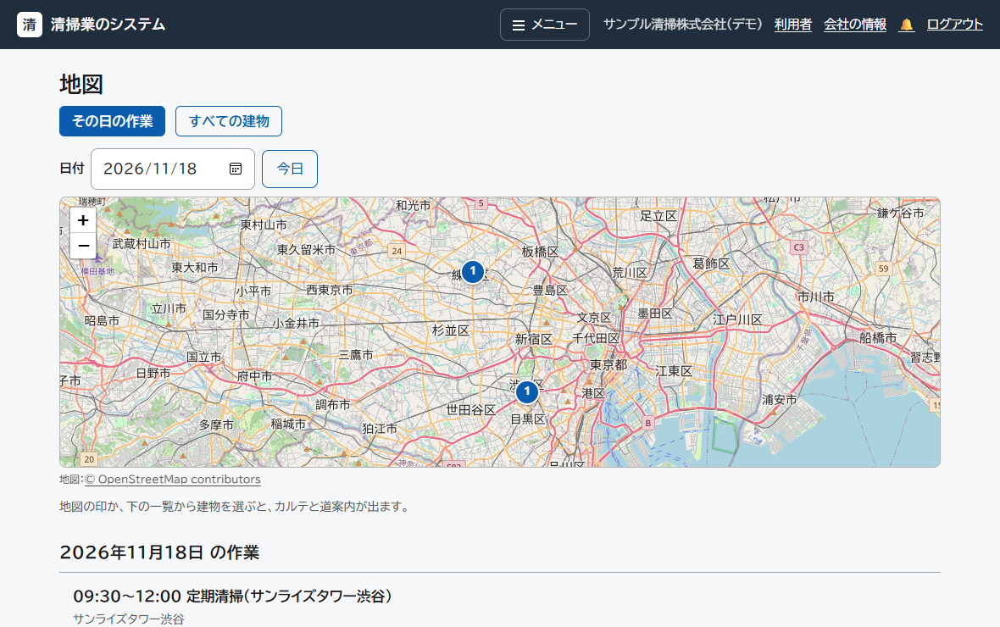

### 5-19. 一括で取り込む

これまで Excel で持っていた取引先・建物・部屋・契約を、一度に登録できます。

1. 「データの取り込み」を開き、「ひな形（Excel）」か「ひな形（CSV）」をダウンロードする
2. ひな形に、データを入れる（見出しの行は変えない）
3. ファイルを選ぶと、**取り込む前の確かめ**が出る。エラーの行と、すでにあるものとの重なりが、一覧に出る
4. よければ「**この内容で取り込む**」を押す

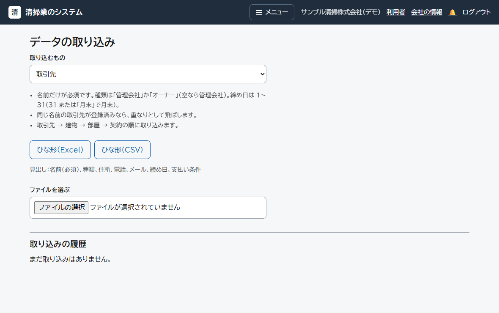

### 5-20. ファイルを置く

建物ごとに、契約書・図面・見積の PDF などを置きます。

1. 「ファイル」を開き、建物を選ぶ
2. ファイルを選んで、「上げる」を押す
3. 取引先にも見せるファイルは、「外部に共有」に切り替える（切り替えるまでは、社内だけです）

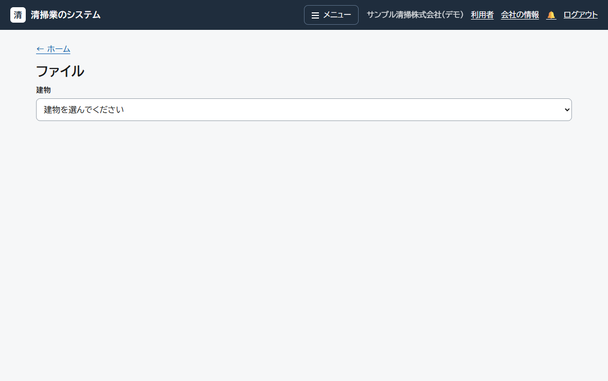

### 5-21. お知らせを見る

「お知らせ」には、予定の変更・明日の作業・期限の近い案件・出ていない報告書・見積の承認・入金の遅れなどが並びます。読んだものは、「既読にする」を押します（「すべて既読にする」もあります）。

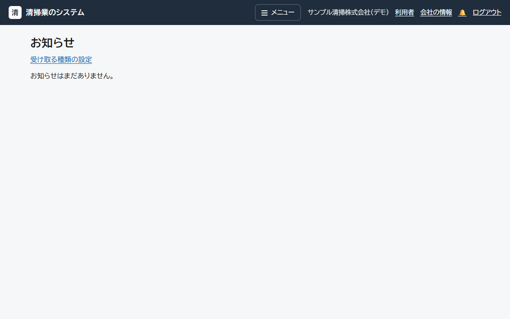

## 6. 管理者編：はじめの設定

会社を使い始めるときに、管理者が行う設定です。

### 6-1. 会社の情報を入れる

1. 画面の上の「会社の情報」を開く
2. 会社の名前・住所・電話・**インボイスの登録番号**（T と13桁の数字）を入れて、「保存」を押す

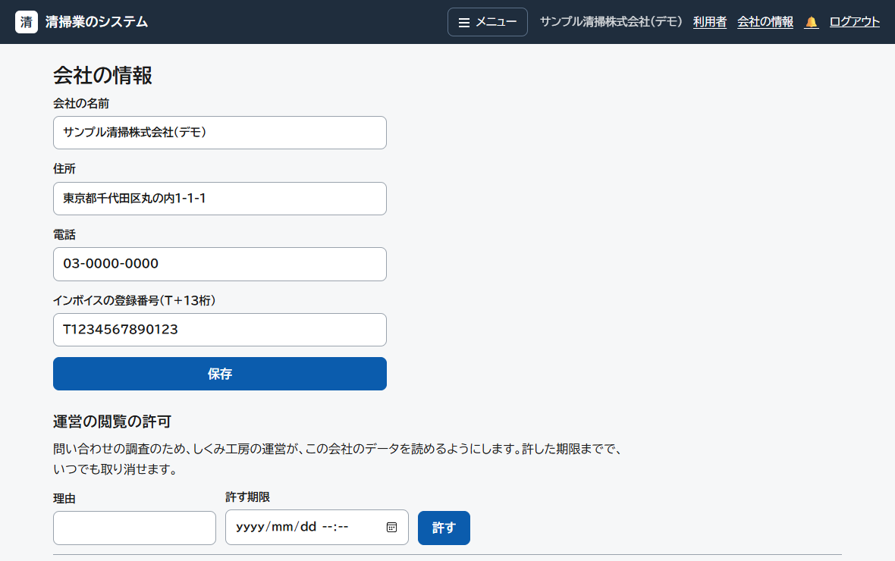

> **注意**　インボイスの登録番号は、請求書に載ります。間違いがないか確かめてください。

### 6-2. 利用者を招待する

1. 画面の上の「利用者」を開く
2. 「招待するメールアドレス」を入れ、「役割」（社員・スタッフ・外部）を選んで、「招待する」を押す
3. 相手に、招待のメールが届く（**7日間・1回だけ**有効）
4. 招待された人が所属すると、「利用者」の一覧に出る

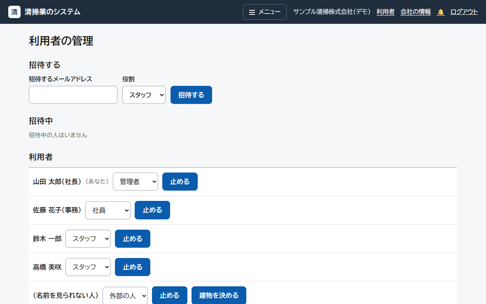

| 役割 | 向いている人 | できること |
|---|---|---|
| 管理者 | 社長・責任者 | すべて（利用者の管理を含む） |
| 社員 | 事務・営業 | 案件・見積・契約・請求・登録・予定の割り当て（金額も見える）。利用者の管理はできない |
| スタッフ | 現場の人 | 自分の担当の作業と、現場の記録。金額と見積は見えない |
| 外部 | 管理会社・オーナー | 専用ページだけ |

### 6-3. 外部の人に、見せる建物を決める

外部の人（取引先の担当者）を招待したら、**見られる建物**を決めます。決めるまでは、何も見えません。

1. 「利用者」の一覧で、外部の人の「建物を決める」を押す
2. 「見られる建物の ID」の欄に、見せる建物の ID を、**1行に1つ**ずつ入れる（建物の ID は、建物の詳細の画面の URL の「id=」のあとの文字列です）
3. 「建物を保存」を押す

### 6-4. 役割を変える・止める

- 役割を変えるときは、一覧の役割を選び直して、「役割を保存」を押す
- 使わなくなった人は、「止める」を押す。**止めた人は、すぐに入れなくなります**。記録は残ります。もう一度使うときは、「戻す」を押す

### 6-5. はじめに登録しておくもの

次の順に登録すると、すぐに仕事を始められます。

| 順 | 登録するもの | 参照 |
|---|---|---|
| 1 | 取引先と建物（一括でもよい） | 5-17、5-19 |
| 2 | 建物カルテ、部屋と場所 | 5-17 |
| 3 | 報告のひな形 | 5-12 |
| 4 | 品名の候補 | 5-5 |
| 5 | 利用者（社員・スタッフ）の招待 | 6-2 |
| 6 | 通知の設定 | 2-4 |

### 6-6. しくみ工房（運営）に、閲覧を許す

操作の相談や不具合の調査で、運営が会社のデータを見る必要があるときは、**管理者が許したあいだだけ**、**見るだけ**で開けます。

1. 「会社の情報」の、「運営の閲覧の許可」で、理由と**期限**を入れる
2. 「許す」を押す
3. 調査が終わったら、「取り消す」を押す。期限が来ると、自動で見られなくなります

> **覚えておくこと**　許していないときは、運営も、会社のデータを見られません。

## 7. 取引先編：専用ページ

管理会社・オーナーの担当者が、**進み具合と報告書を見る**ための画面です。

### 7-1. 見られるもの

専用ページには、**許可された建物だけ**について、次のものが出ます。

- 建物の名前と住所
- 作業の予定と、進み具合（日と状況）
- 提出された見積
- 提出された清掃報告書と、その写真
- 共有されたファイル

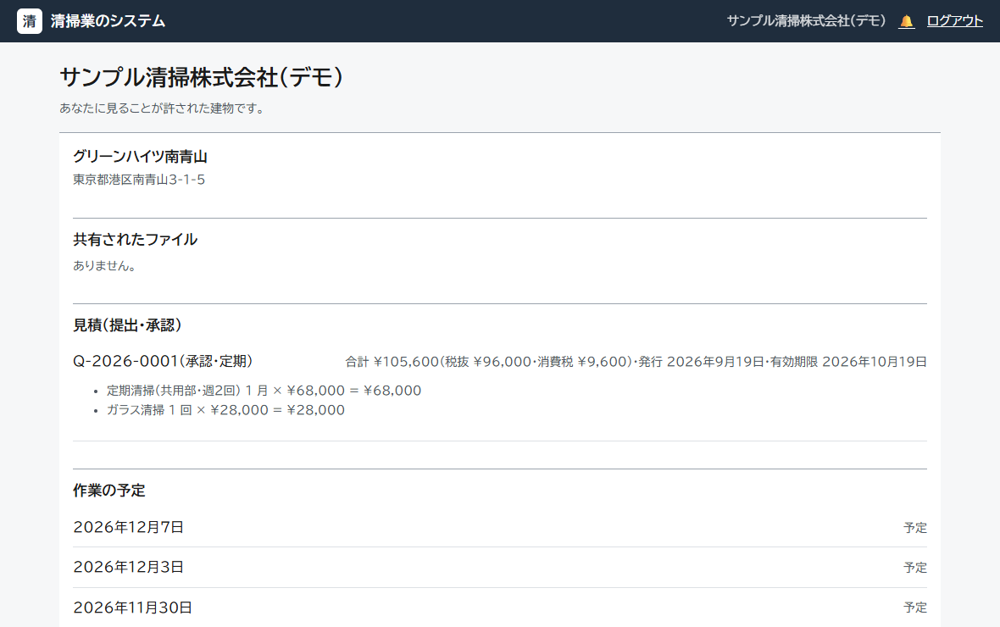

### 7-2. 入る手順

1. 招待のメールのリンクを開き、「所属する」を押す
2. 次回からは、ログインの画面で、メールアドレスを入れて、「ログインのリンクを送る」を押す
3. 届いたメールのリンクを開くと、専用ページが開く

> **覚えておくこと**　専用ページは、**見るだけ**です。内容を直すことはできません。見えないものがあるときは、清掃会社に、見せる設定を頼んでください。

## 8. 困ったとき

### 8-1. よくある質問

| 困りごと | 対処 |
|---|---|
| ログインのメールが届かない | 迷惑メールを探す。入れたメールアドレスが、登録のものと同じか確かめる。それでも届かないときは、管理者に連絡する |
| 招待のリンクが開けない | 期限（7日）が過ぎているか、一度開いている。管理者に、招待し直してもらう |
| 画面に、見えるはずの案件・作業が出ない | スタッフは、自分が担当のものだけが出る。事務に、担当に入れてもらう |
| 「送れていない」の件数が減らない | 電波のある所で、画面を開いておく。写真は、「今すぐ送る」を押す |
| 提出した見積を直したい | 直せない。「直した版を作る」で、新しい見積を作る |
| 発行した請求書を直したい | 直せない。「取り消す」を押して、作り直す |
| 確認した報告書を直したい | 事務が「下書きに戻す」を押すと、直せる |
| 取引先・建物が消せない | 建物・契約・請求書・先の予定が残っている。理由は、画面に出る |
| 外部の人に、何も見えない | 利用者の管理で、見られる建物を決めたか、報告書を提出したか、ファイルを共有にしたかを確かめる |

### 8-2. 画面に出る文言と対処

| 画面の文言 | 意味と対処 |
|---|---|
| ほかの人が直しています | 同じ作業を、別の人が先に直した。画面を開き直して、最新の内容で、もう一度直す |
| この操作をする権限がありません | 自分の役割では、できない操作。必要なら、管理者に役割を相談する |
| 〜があるので消せません | 使われているので、消せない。理由に書かれたものを、先に片づける |
| 請求書に載っている月があるので〜 | 請求書に載った月は、変えられない。載っていない月から、変える |
| 接続の設定がありません | 管理者・運営に連絡する（環境の設定が要る） |

### 8-3. 問い合わせるとき

次の3つを伝えると、早く調べられます。

1. どの画面で、何をしたか（できれば、画面の写真）
2. 画面に出た文言
3. ログインに使っているメールアドレスと、会社の名前

## 9. 用語集

| 言葉 | 意味 |
|---|---|
| 会社 | このシステムを使う清掃会社。データは、会社ごとに分かれる |
| 取引先 | 仕事を頼む側。管理会社かオーナー |
| 建物 | 清掃する物件（マンション・ビル） |
| 建物カルテ | 建物ごとの現場の情報。入り方・鍵の場所・駐車場・ゴミの日・管理人の連絡先・注意すること |
| 案件 | 1つの依頼や気づき。依頼元・建物・分類・内容・期限・担当・状況を持つ |
| 見積 | 取引先・建物に出す見積書。提出すると直せない |
| 清掃の契約 | 承認された見積から作る。定期（頻度つき）と単発（特別清掃）がある |
| 基本の清掃 | 定期の契約で、毎回行う作業の項目と、その月額 |
| オプション | 基本に足す作業（ガラス清掃など）。頻度と金額を、別に決める |
| 作業 | 建物で、ある日に行う清掃。契約の頻度から、自動で予定ができる |
| 予実 | 作業の予定と、実際の実績の比べ |
| 清掃報告書 | 1回の作業の報告。項目のチェック・写真・メモ。下書き・確認済み・提出の3段階 |
| ひな形 | 建物ごとの報告の項目の並び |
| 請求書 | 取引先ごと・月ごとの請求。発行すると直せない |
| 小口現金 | スタッフに渡す現金と、その出入りの記録 |
| 専用ページ | 外部（取引先）の人だけが入る画面 |
| 論理削除 | 画面から消しても、記録としては残る削除 |

### 権限の一覧

| できること | 管理者 | 社員 | スタッフ | 外部 |
|---|---|---|---|---|
| 利用者の管理・会社の情報 | ○ | | | |
| 取引先・建物・ひな形・ファイルの登録 | ○ | ○ | | |
| 案件・見積・契約・請求・費用 | ○ | ○ | | |
| 金額を見る | ○ | ○ | | |
| 作業の割り当て・全員の予定・報告書の確認 | ○ | ○ | | |
| 現場の記録（開始・終了、写真、報告書） | ○ | ○ | ○ | |
| 全員の小口の管理 | ○ | ○ | | |
| 専用ページ（許可された建物だけ） | | | | ○ |
