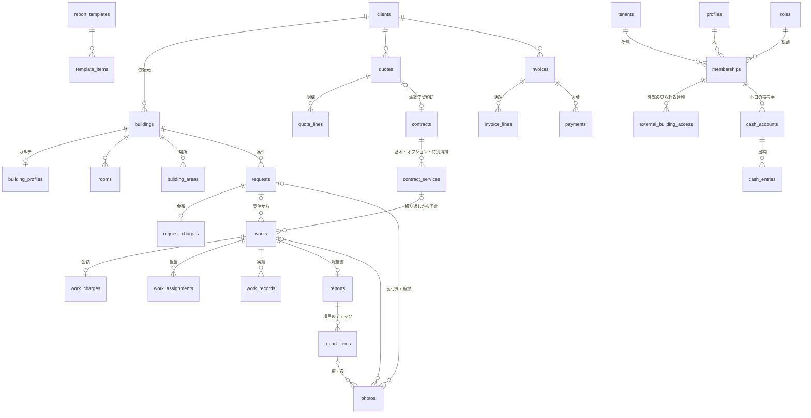

# データの形（cleaning：清掃業のシステム）

全部の機能で使う表と、そのつながり。機能ごとの design.md は、ここを正として表を使う。表や列を足すときは、ここを先に直す。決まりは [constitution.md](constitution.md)、言葉は [product.md](product.md)、機能ごとの CRUD は [crud.md](crud.md)。

考え方は2つ。

- **会社をまたいでデータが漏れないことは、DB だけで守る**（会社の ID・RLS・外部キー）。画面や処理の書き漏れがあっても漏れない
- **それ以外は簡単にする**。業務の決まりは DB の関数（RPC）か Edge Function に置き、トリガーや列の組み合わせで表さない（受け持つ場所は constitution の1章）

## 1. すべての表に共通の決まり

| 列 | 中身 |
|---|---|
| `id` | uuid。現場の記録（写真・実績・報告書・項目のチェック・小口の出入り）は、端末で作った uuid をそのまま使う（二度送っても1件） |
| `tenant_id` | 会社。共通のマスタ（`roles`・`permissions`）と人（`profiles`）のほかは、すべての表が持つ |
| `created_at`・`created_by`・`updated_at`・`updated_by` | だれがいつ作り、直したか |
| `deleted_at` | 論理削除。消した行は普段の画面に出さない |

- **親と子は同じ会社**：親は `unique (tenant_id, id)` を持ち、子は `(tenant_id, 親の id)` の組で参照する。別の会社の親につなぐ行は、DB が受け付けない
- 一意の制約は、消していない行だけ（`… where deleted_at is null`）
- 索引：`tenant_id` から始まる索引と、外部キーの列の索引。取引先・建物の名前には部分一致の索引（pg_trgm）
- 現場の記録は、さらに `client_created_at`（端末で作った時刻）・`received_at`（届いた時刻）・`device_id` を持つ
- 2人が別々に直すことがある表（`works`・`reports`）は `version` を持つ。古い版からの書き込みは受け付けず、画面で「ほかの人が直しています」と出す
- 金額は円の整数。税は帳票ごとに1回かけて切り捨て、税率は帳票に持つ。日時は `timestamptz`、画面は Asia/Tokyo
- 状況（status）は check 制約で値を決める。切り替えは RPC だけが行う
- **電波のない間の操作**：端末にためるのは「書く行」か「呼ぶ RPC と引数」。現場の RPC（作業の開始・終了など）は、端末で作った uuid を引数で受け取り、同じ uuid の二度目は何もしないで前の結果を返す
- **使われているものは消さない**：部屋・場所・ひな形・ひな形の項目は `active`（使う・使わない）を持つ。案件・写真・作業から使われていれば、消さずに「使わない」にする（新しく選ぶ候補に出さない）

## 2. 全体の図（主な表とつながり）

真ん中は **作業（works）**。契約の繰り返し・案件・特別清掃のどこから来ても、現場では1つの作業として担当・実績・写真・報告書を持つ。請求書の明細は、契約の中身（月額）・作業の金額（回ごと）・案件の金額のどれか1つを元にする。

## 3. 表の一覧（機能ごと）

型（A・B・C1・C2・D・E）は4章の policy の型。

### 001 会社と利用者

| 表 | 型 | 主な列 | メモ |
|---|---|---|---|
| `tenants` 会社 | E | name、address、phone、invoice_reg_no（インボイスの登録番号）、status（試用・有効・止め）、trial_ends_at | 運営が作る |
| `offices` 拠点 | A | name、address | |
| `profiles` 人 | ― | id（= ログインの ID）、display_name | 会社をまたぐ。メールアドレスは写さない（ログインの側だけ）。見られるのは、同じ会社に所属する人（外部の人を除く）と本人。外部の人が見られるのは、自分に見せる見積と報告書を作った・確かめた人の名前だけ |
| `roles` 役割 | ― | code（admin・member・staff・external）、name | 共通のマスタ |
| `permissions` 権限 | ― | code、name | 共通のマスタ。下の10個 |
| `role_permissions` | ― | role_id、permission_id | 役割 × 権限 |
| `memberships` 所属 | E | user_id、role_id、office_id、client_id（外部の人のとき）、status（招待中・有効・止め） | `unique (tenant_id, user_id)`。権限の判定は毎回ここを見る（ログインの鍵に会社と役割を入れない。止めたらすぐ効く） |
| `invitations` 招待 | E | email、role_id、token_hash、expires_at、accepted_at | 鍵はハッシュだけ持つ。7日、1回だけ |
| `external_building_access` | E | membership_id、building_id | 外部の人が見られる建物 |
| `support_access_grants` 運営の閲覧の許可 | E | granted_by、reason、starts_at、ends_at、revoked_at | 会社の管理者が期限つきで許したときだけ、運営が見られる |
| `audit_logs` 変更の履歴 | E | table_name、row_id、action、changed（変わった列の前と後）、actor、source（画面・RPC・定時の処理・取り込み・運営）、request_id、at | トリガーで書く。だれも直せない・消せない。付けるのは型 A・B・E の表だけ（型 C の現場の記録は数が多いので、作った時刻・届いた時刻・version で追う） |
| `job_runs` 処理の記録 | E | kind、started_at、ended_at、status、counts、error | Edge Function と定時の処理が、会社ごと・1回ごとに書く（会社をまたぐ処理も会社ごとに分けて回すので、tenant_id は必ず入る）。作った行に `run_id` を残す |
| `client_error_logs` 端末のエラー | C1 | membership_id、device_id、app_version、kind（送れない・画面のエラー）、message、context、at | 端末が書き足すだけ |
| `document_counters` 番号 | E | kind（quote・invoice）、year、last_no | 番号は RPC だけが振る |

権限の10個と、役割ごとの初めの割り当て（`role_permissions`。product.md の2章の役割に合わせる）：

| 権限 | 中身 | 管理者 | 社員 | スタッフ | 外部 |
|---|---|---|---|---|---|
| `user.manage` | 利用者の招待・役割・止め、会社の情報 | ○ | | | |
| `master.edit` | 取引先・建物・部屋・場所・ひな形・ファイル・取り込み | ○ | ○ | | |
| `request.edit` | 案件 | ○ | ○ | | |
| `quote.edit` | 見積・品名の候補 | ○ | ○ | | |
| `contract.edit` | 契約・決まった担当・作業の金額 | ○ | ○ | | |
| `invoice.edit` | 請求・入金・費用 | ○ | ○ | | |
| `amount.read` | 金額を見る（型 B を読む） | ○ | ○ | | |
| `work.assign` | 作業の割り当て、全員の予定と現場の記録を見る、報告書の確認 | ○ | ○ | | |
| `field.record` | 現場の記録（写真・報告書・開始と終了・気づきから案件） | ○ | ○ | ○ | |
| `cash.manage` | 全員の小口（渡す・確認・締め） | ○ | ○ | | |

- 外部の人は権限を持たず、型 D の決まりだけで読む
- 運営（しくみ工房）は役割ではない。会社の所属を持たず、会社をまたぐ定時の処理と、`support_access_grants` で許された期間の閲覧だけを行う。許された期間は、すべての型を読める（書けない）

### 002 取引先・建物・部屋

| 表 | 型 | 主な列 | メモ |
|---|---|---|---|
| `clients` 取引先 | A | kind（管理会社・オーナー）、name、address、phone、email、closing_day、payment_terms | |
| `client_contacts` 担当者 | A | client_id、name、email、phone | 外部の人として招待する元 |
| `buildings` 建物 | A＋D | client_id、owner_client_id、name、address、lat、lng、location_fixed | 外部の人も、許された建物の名前と住所は読める。位置は 013 |
| `building_profiles` 建物カルテ | A | building_id（1対1）、entry、key_place、parking、garbage_days、manager_contact、cautions | 鍵の場所や入り方は、外部の人に見せないので、建物とは別の表にする |
| `rooms` 部屋 | A | building_id、room_no、floor、active | 入居者の名前は持たない |
| `building_areas` 場所 | A | building_id、name、sort、active | 写真とひな形の項目が使う |

- 取引先と建物の削除は RPC で行う。取引先は、建物・契約・請求書があれば消せない。建物は、先の予定や有効な契約があれば消せない（理由を返す）
- 消す RPC は、子も一緒に論理削除する（取引先 → 担当者、建物 → カルテ・部屋・場所・ひな形）。RLS は親が消えたかを見ないので、子を残さない
- 「使われていれば消さない」の条件は、登録の表 `app.usage_refs`（下の4章の「仕組み」）に1行ずつ置く。消す RPC（`delete_client`・`delete_building`・`delete_room`・`delete_building_area`）が読む。後の機能は、自分の表を作ったら、自分の列名・状況の値がここの条件と合うかを確かめ、合わなければ行を直す

### 003 案件

| 表 | 型 | 主な列 | メモ |
|---|---|---|---|
| `requests` 案件 | A | client_id、building_id、room_id、source（入口）、category、title、detail、due_date、assignee_id、status（受付・対応中・完了・取消） | 金額は持たない。スタッフが読めるのは自分の担当の案件だけ。スタッフは気づきの写真から案件を作れる（RPC。`field.record`）。そのときは写真の側に request_id を入れる |
| `request_charges` 案件の金額 | B | request_id（1対1）、amount、billable | |

### 004 見積

| 表 | 型 | 主な列 | メモ |
|---|---|---|---|
| `items` 品名の候補 | B | name、unit、unit_price、kind | |
| `quotes` 見積 | B＋D | client_id、building_id、request_id、kind（案件・定期・特別清掃）、number、issue_date、valid_until、tax_rate、subtotal、tax、total、status（下書き・提出・承認・不成立）、previous_id（直した版の元）、note（備考）、submitted_at（提出した時刻）、decided_at・decided_by（承認・不成立にした時刻と人）、decision_note（不成立の理由） | 合計は提出の RPC で計算して入れる。`request_id` は `(tenant_id, request_id)` の組で `requests` を指す外部キー（空でもよい）。番号・提出・決めた列は、提出・承認・不成立の RPC だけが入れる |
| `quote_lines` 明細 | B＋D | quote_id、item_id、line_kind（基本・オプション・単発）、name、qty、unit、unit_price、amount、recurrence（定期のとき）、sort（並び順） | 品名と単価は写して持つ。`amount` は生成列（`round(qty × unit_price)`）で、画面からは書けない |

提出した見積は、RLS で書き換えを止める（直せるのは status が下書きの行だけ）。直すときは、`previous_id` に元を入れた新しい見積を作る。承認は、最初は社員が承認の RPC で記録する（取引先から返事をもらったとき）。外部の人が専用ページで承認を押す形は、005 の design で RPC 1つとして決める。

### 010 清掃の契約（定期・単発）

| 表 | 型 | 主な列 | メモ |
|---|---|---|---|
| `contracts` 契約 | B | client_id、building_id、source（見積・取り込み）、quote_id（取り込みのときは空）、kind（定期・単発）、start_date、end_date、status（有効・終了） | `unique (quote_id)`。source が見積なら quote_id は必ず入る（check） |
| `contract_services` 清掃の中身 | B | contract_id、service_key、service_kind（基本・オプション・特別清掃）、name、amount、billing（毎月・行った回ごと）、recurrence、start_time、end_time、report_template_id、valid_from、valid_to | 下の説明 |
| `contract_service_staff` 決まった担当 | A | contract_service_id、membership_id | 予定を作るときの担当の初めの値。金額を持たないので型 A（書けるのは `contract.edit`） |

- **繰り返し（recurrence）は、RRULE の文字列1つ**で持つ。例：毎週月・木 `FREQ=WEEKLY;BYDAY=MO,TH`、隔週火曜 `FREQ=WEEKLY;INTERVAL=2;BYDAY=TU`、月2回 `FREQ=MONTHLY;BYMONTHDAY=10,25`、第2火曜 `FREQ=MONTHLY;BYDAY=2TU`、3か月ごと `FREQ=MONTHLY;INTERVAL=3`、単発（特別清掃）`FREQ=DAILY;COUNT=1`。起点（RRULE の DTSTART）は `valid_from` で、単発はその日に行う。読み解きと予定の作成は Edge Function（RRULE のライブラリ）で行い、画面には「毎月 第2火曜」のように訳して見せる
- **金額・繰り返しの変更**は、契約の変更の RPC で行う。今の行を `valid_to` で閉じ、同じ `service_key` で新しい行を作る（どの月にいくらだったかが残る）。あわせて、変更の日より先の予定を取り消して作り直す
- 予定は、定時の処理で2か月先まで作る。`works` の `unique (service_key, scheduled_date) where run_id is not null and deleted_at is null` で、二度動いても重ならない（手で足した作業は数えない）
- 手で足す作業（臨時の訪問など）は、案件か契約の中身のどちらかを選んで作る（作業は必ずどちらかを元に持つ）

### 008 現場の写真・009 清掃報告書・012 作業の予定と実績

| 表 | 型 | 主な列 | メモ |
|---|---|---|---|
| `works` 作業 | A＋D | building_id、contract_service_id か request_id（どちらか1つ。check）、service_key、title、report_template_id（写す）、scheduled_date、start_time、end_time、status（予定・実施中・完了・行わず・取消）、version、run_id | スタッフが契約を読まずに済むよう、名前とひな形を写す。スタッフが読めるのは自分の担当の作業だけ（`work.assign` があれば全部）。外部の人は、許された建物の作業の日と状況を読める（進み具合。担当・実績・位置は読めない） |
| `work_charges` 作業の金額 | B | work_id（1対1）、amount | 行った回ごとに請求するとき |
| `work_assignments` 担当 | A | work_id、membership_id | |
| `work_records` 実績 | C1 | work_id、membership_id、started_at、ended_at、開始と終了の緯度・経度（了承したときだけ）、distance_m、distance_warning | 位置は 90 日で消す（距離と警告は残す） |
| `report_templates` ひな形 | A | building_id、name、active | |
| `template_items` ひな形の項目 | A | template_id、area_id、name、sort、active | |
| `reports` 報告書 | C2＋D | work_id（unique）、status（下書き・確認済み・提出）、remarks、checked_by、checked_at、submitted_at、version | 作業の担当なら、だれでも書ける。書けるのは下書きの間だけ（確認・提出のあとは RLS で止める） |
| `report_items` 項目のチェック | C2 | report_id、template_item_id、done、note | |
| `photos` 現場の写真 | C2＋D | building_id、area_id、room_id、work_id、report_item_id、request_id（建物のほかは任意）、kind（前・後・気づき）、taken_at、taken_by、storage_path、thumb_path、width、height、bytes | ファイルは `<tenant_id>/photos/…`。一覧は小さな画像だけを読む。Exif の位置は端末で消してから送る。持ち主は作業の担当（作業のない写真は撮った本人）。`work_id` は `(tenant_id, work_id)` で 010 の `works` を指す外部キー（空でもよい）。報告書が下書きの間だけ直せる |

予実は表を作らず、予定（works）と実績（work_records・reports）を比べる view で出す。

### 005 ファイルと専用ページ

| 表 | 型 | 主な列 | メモ |
|---|---|---|---|
| `files` ファイル | A＋D | building_id、request_id、quote_id、name、mime、size、storage_path、shared_external | 書けるのは `master.edit` |

ファイルは、置き場所に上げてから行を作る。行のないファイルと、ファイルのない行は、定時の処理（Edge Function `sweep-files`。会社ごとに `job_runs` に記録）で掃除する。

- `building_id` は必須（組の外部キー）。`request_id`・`quote_id` は、`(tenant_id, …)` の組で `requests`・`quotes` を指す外部キー（空でもよい）。`storage_path` は `<tenant_id>/files/…` で始まる（check）。作ったあとに直せるのは、名前・共有・つなぎ・消す（`deleted_at`）だけ
- 外部の人は、許された建物の、`shared_external` で共有された、消していないファイルの行だけを読む（型 D）。置き場所は直接は読めず、期限つきの URL（Edge Function `sign-file-urls`）で渡す
- 専用ページ（`/portal/`）は新しい表を作らず、外部の人の権限のまま既存の表を読む。見積・報告書・作業の区画は、004・009・012 が登録簿に足す（005 の design）

### 006 小口現金・レシート

| 表 | 型 | 主な列 | メモ |
|---|---|---|---|
| `cash_accounts` 小口 | C1 | holder_id（持ち手の所属）、name | 残高は出入りの合計（view）。持ち手は読むだけ。作る・直すのは `cash.manage` |
| `cash_entries` 出入り | C1 | account_id、holder_id（小口の持ち手と同じ）、entry_date、direction（入・出）、amount、purpose、building_id、work_id、receipt_id、status（下書き・確認済み・締め済み）、confirmed_at・confirmed_by・closed_at・closed_by、client_created_at・received_at・device_id | 持ち手は自分の分を書ける。全員の分は `cash.manage`。確認・締めは RPC（cash.manage）で、確認のあとは RLS で直せない |
| `receipts` レシート | C1 | holder_id、storage_path、read_amount、read_date、status（読み取り待ち・読み取り済み・失敗・手入力）、client_created_at・received_at・device_id | 読み取りは Edge Function |

- 持ち手と組の外部キー（`(tenant_id, account_id, holder_id)`・`(tenant_id, receipt_id, holder_id)`）で、出入りは小口・レシートと同じ持ち手に揃える。`building_id` は `(tenant_id, building_id)` で 002 の `buildings` を指す。`work_id` は、`(tenant_id, work_id)` で 010 の `works` を指す外部キー（空でもよい。波 3 の取り込みで足した）
- 残高は view `cash_account_balances`（`security_invoker`。残高・確認済み以上の残高・下書きの数）。確認・月の締め・持ち手の表示名は RPC（`confirm_cash_entries`・`close_cash_month`・`cash_holder_names`。どれも `cash.manage`）

### 011 請求

| 表 | 型 | 主な列 | メモ |
|---|---|---|---|
| `invoices` 請求書 | B | client_id、period、number、issue_date、due_date、tax_rate、subtotal、tax、total、status（下書き・発行・送付・一部入金・入金済み・取消）、previous_id | 取引先ごとに月1枚（`unique (client_id, period) where deleted_at is null and status <> '取消'`） |
| `invoice_lines` 明細 | B | invoice_id、service_key＋service_month か work_id か request_id（どれか1つ。check）、name、qty、unit_price、amount | 金額は写して持つ |
| `payments` 入金 | B | invoice_id、paid_on、amount、note | 人が記録する |

- 下書きは、請求の下書きの RPC で作る。合計は発行の RPC で計算して入れ、発行した請求書は RLS で書き換えを止める
- 同じ元を二度請求しない：`unique (service_key, service_month)`・`unique (work_id)`・`unique (request_id)`、どれも `where deleted_at is null`。取り消しの RPC は、請求書を「取消」にし、明細に `deleted_at` を入れる（明細が空くので、出し直せる）
- 入金の記録・直し・消しは、入金の RPC で行い、請求書の status（一部入金・入金済み）も同じ中で変える
- 請求書に載ったもの（消していない明細から指されている案件の金額・作業の金額・契約の中身）は、RLS で直せなくする

### 013 地図・014 取り込み・015 お知らせ・016 売上と粗利・007 課金

| 表 | 型 | 主な列 | メモ |
|---|---|---|---|
| （013） | ― | `buildings.lat・lng`、`work_records` の位置 | 新しい表は作らない |
| `import_jobs` 取り込み | E | kind、file_path、status、total_rows、error_rows | 読み込みは Edge Function |
| `notification_kinds` 種類の一覧 | M | code、name、default_push、default_email、required_perm（受け取るのに要る権限。なければ空）、sort | 足せるのはマイグレーションだけ。種類を足すときは、ここに1行足す |
| `notification_settings` | C1 | membership_id、kind、channel（通知・メール）、enabled | 行がなければ、種類の `default_push`・`default_email` |
| `push_subscriptions` | C1 | membership_id、endpoint、keys | 端末ごと |
| `notifications` お知らせ | C1 | membership_id、kind、title、body、link、channel（一覧・通知・メール）、status（送る前・送った・失敗）、error、sent_at、read_at、run_id、dedupe_key（同じ出来事を二度作らない印） | 出来事の RPC（見積の承認など）か定時の処理が、共通の関数 `app.enqueue_notification` で「送る前」で作り、Edge Function が送る。180 日で消す。本人は `read_at` だけ直せる |
| `costs` 費用 | B | month、building_id、contract_id、kind（外注・材料・その他）、amount、note | 手で入れる。書けるのは `invoice.edit` |
| `subscriptions` 課金 | E | plan、status、stripe_customer_id、current_period_end | 007 の design で決める |

売上と粗利は、請求書の明細（売上）と費用・小口（費用）を集める view で出す。遅くなったら、前の月までを毎晩の集計の表にする。

## 4. 漏らさないための policy の型

すべての表で RLS を ON にし、下の型のどれかを付ける（C は持ち主の決め方で C1 と C2 に分ける）。policy はこの型からまとめて作り、表ごとに手で書き分けない。どの型も「自分が有効な所属を持つ会社の行だけ」が前提で、ほかの会社の行は読めない・書けない。

| 型 | 読める人 | 書ける人 | 表の例 |
|---|---|---|---|
| A 業務 | 会社の中の人（外部を除く）。作業と案件は、スタッフなら自分の担当だけ | その権限を持つ人（`master.edit` など） | 取引先・建物・カルテ・案件・作業・ひな形・ファイル・決まった担当 |
| B 金額 | `amount.read` を持つ人 | その権限を持つ人 | 案件と作業の金額・見積・契約・請求・費用・品名の候補 |
| C1 現場の記録（本人） | 持ち主の本人と、`work.assign`（小口は `cash.manage`）を持つ人 | 持ち主の本人（確認の後は書けない）。表のメモに書いた権限の人（小口の `cash.manage` など） | 実績・小口・レシート・お知らせ・端末のエラー |
| C2 現場の記録（作業の担当） | その作業の担当の全員と、`work.assign` を持つ人 | その作業の担当の全員（報告書が下書きの間だけ） | 報告書・項目のチェック・写真 |
| D 外部に見せる | A〜C に足す。外部の人は、`external_building_access` の建物の、建物の名前と住所・作業の日と状況・提出と承認の見積・提出した報告書とその写真・`shared_external` のファイルだけ | 外部の人は書けない | 建物・作業・見積・報告書・写真・ファイル |
| E 管理 | `user.manage` を持つ人と、自分の行（自分が所属する会社・自分の所属・自分の外部の建物）。運営は `support_access_grants` の期間だけ | RPC と Edge Function だけ（変更の履歴はだれも書き換えられない） | 会社・所属・招待・変更の履歴・処理の記録 |

- 判定は1つの関数 `has_perm(tenant_id, perm)` だけ。`stable` にし、policy では `(select auth.uid())` の形で使う。`memberships (user_id, tenant_id)` に索引
- view はすべて `security_invoker = true`（見る人の権限で絞る）。`security definer` の関数は、判定と変更の履歴と RPC だけにし、`search_path` を固定する。RPC は `security definer` で RLS を通らないので、中で必ず `has_perm` と、行の会社・状況（下書きか など）を確かめる。RLS で決めた固定（提出・発行・確認のあとは書けない）と同じ決まりを、RPC の中でも守る
- ファイルの置き場所の policy は、パスの最初のフォルダが自分の会社の ID のときだけ許す。表の `storage_path` にも `<tenant_id>/` で始まる check 制約
- `service_role` のキーは Edge Function の中だけ。さらに、使ってよいのは会社をまたぐ定時の処理（予定の作成・お知らせ・掃除・位置の消去）だけにする
  - 会社のデータを書く Edge Function（取り込み・招待など）は、操作した人のログインの鍵で RPC を呼ぶ（RLS を通す）
  - 会社をまたぐ定時の処理は、会社ごとに分けて回し、書く行の `tenant_id` は元の行（契約・作業）から取る。DB のテストで、別の会社の行を作らないことを確かめる
- DB のテストは、型ごとに同じテスト（別の会社の行が見えない・書けない、役割ごとの読み書き）を、すべての表に流す。型の付け忘れは、テストで「RLS が ON で、型の policy がある」ことを表ごとに確かめて止める

### 型を付ける仕組み（波 0〜1 で入れたもの）

- **`app.apply_policy(表, 型, オプション)`**：A・B・C1・C2・E の型から、policy・列の権限・変更の履歴・`updated_at` のトリガーをまとめて付ける。もう一度呼べる（前の `tp_` の policy を外して付け直す）。D は `external_read` に条件を渡して足す。migration だけが呼べる（`authenticated` などには実行を渡さない）。オプションは `tenant_col`・`write_perm`・`lock_sql`・`read_scope`・`read_bypass`・`owner_col`・`supervise_perm`・`scope_fn`・`scope_col`・`insert_only`・`read_perm`・`own_row_sql`・`external_read`・`audit`（意味は関数の先頭の注釈）
- **`app.policy_registry`**：どの表に何の型を付けたかの登録（`table_name`・`policy_type`・`tenant_col`・`opts`）。`apply_policy` が自動で書く。D を足した表は `A+D` のように登録する。DB のテストが、表の付け忘れと、型ごとの漏れを見つけるのに使う
- **型 M（共通のマスタ）**：会社の ID を持たない表。ログインした人は読むだけ（書けない）。`app.apply_master_policy(表)` で付ける。`roles`・`permissions`・`role_permissions`・`notification_kinds`
- **型 P（人）**：`profiles`。同じ会社に所属する人（外部の人を除く）と本人が読める。書き換えられるのは本人の表示名だけ。policy は `apply_policy` ではなく、001 のマイグレーションの中で個別に付けて登録する
- **`app.usage_refs`**（002）：使われ方の登録。列は `parent`（client・building・room・area）・`action`（`block`：あれば消さない、`cascade`：親と一緒に論理削除、`in_use`：あれば消さずに「使わない」にする）・`child_table`・`where_sql`（子の列は修飾せずに書き、`$2` が親の id。`tenant_id` と `deleted_at is null` は自動で足す）・`reason`。子の表がまだない間は飛ばす。今ある条件の仮置き（後の機能が確かめる）：契約の状況 `active`、作業の状況 `scheduled`・`in_progress`
- **`app.enqueue_notification(会社, 所属, 種類, 題名, 本文, リンク, 重複の印, 処理の記録)`**（015）：お知らせを「送る前」で作る共通の関数。後の機能の RPC が、自分の変更と同じトランザクションの中で呼ぶ。種類は `notification_kinds` の `code`（知らない種類・題名が空・アプリの外のリンクは例外）。止められた所属・種類が要る権限を持たない所属・別の会社には、何も作らず 0 を返す（呼んだ側の本体の処理を止めない）。一覧の行（`channel = app`）は常に作り、通知は「本人の設定、なければ種類の初めの値」と有効な端末があるとき、メールは設定または初めの値のとき、行を足す。重複の印が同じなら作らない。会社をまたぐ定時の処理は、service_role だけが呼べる `public.enqueue_notification` を通す

## 5. 調べやすさ

- 変更の履歴で、だれが・どこから（source）・どの操作で（request_id）変えたかを見る。1つの操作で変わった行は request_id でまとめて出る
- 処理が作った行（予定・お知らせ・請求の下書き）は `run_id` から `job_runs` をたどる
- 現場の記録は、端末で作った時刻と届いた時刻を比べる。送り損ねは `client_error_logs` を端末と時刻で探す
- 契約の金額と繰り返しは行を直さず新しい行にし、提出・発行した帳票は変えない。どの時点で何だったかを、後からそのまま見られる
- 消す期間：位置 90 日、端末のエラー 90 日、お知らせ 180 日、処理の記録 1 年。変更の履歴は消さない（とても増えたら、月ごとに分けて持つ）

## 6. 決めたこと

| 決めたこと | 理由 |
|---|---|
| 漏らさない守りは DB（会社の ID・外部キーの組・RLS の型）に置き、業務の決まりは RPC と Edge Function に置く | 守りは書き漏れがあっても効く形にする。業務の決まりをトリガーに散らすと、追いにくくなる |
| 現場の記録の持ち主は、報告書と写真は「作業の担当」、実績と小口は「本人」 | 1つの作業を2人で行うとき、報告書と写真は一緒に作る。実績と小口は人ごとのもの |
| 会社のデータを書く Edge Function は、操作した人の権限で RPC を呼ぶ | RLS を通らない書き込みを、会社をまたぐ定時の処理だけに絞る |
| 請求書に載ったものは直せない。小口は確認のあと直せない | 出した帳票と画面の数字を合わせる |
| 使われている部屋・場所・ひな形は消さずに「使わない」 | 案件・写真・作業のつながりを切らない |
| policy は6つの型（A・B・C1・C2・D・E）からまとめて作る | 約50の表に手で書くと、書き漏れが出る。型ごとのテストで全部の表を確かめられる |
| 金額は別の表（型 B）に分ける | RLS は列を隠せないため |
| 繰り返しは RRULE の文字列1つ | 列の組み合わせの確かめが要らず、どの頻度も同じ形で書ける |
| 契約の中身は、変えるときに新しい行（同じ service_key） | どの月にいくらだったかが残る。予定と請求の二重の防止は service_key で行う |
| 提出・発行した帳票の固定は、トリガーではなく RLS の条件で行う | 「下書きの行だけ直せる」の1行で済む |
| 合計は、提出・発行の RPC で1回だけ計算する | 明細を直すたびに計算し直すトリガーが要らない |
| 建物カルテは建物とは別の表（型 A だけ） | 外部の人は建物の名前と住所を読むが、鍵の場所や入り方は見せない。RLS は列を隠せないので、表を分ける |
| 運営は役割ではなく、許された期間だけ読む | 会社の所属を持たせないことで、普段は RLS で何も読めない |
| 変更の履歴は、最初は1つの表 | 月ごとに分けて持つ手入れは、行がとても増えてからで足りる |
| 写真と案件のつながりは、写真の側だけ | 同じつながりを2か所に持たない |
| 作業と報告書に version を持つ | 電波のない間に2人が直したとき、先の直しが消えない |
| 権限は10個から始める | 役割ごとの表の手入れとテストを少なくする |

## 7. 決まっていないこと

- 写真の縮小の幅と、写真を残す期間（008 の design）
- 契約の途中で金額が変わった月を日割りにするか（011 の design。行は分けて持つので、どちらにもできる）
- 退会した会社のデータを消すまでの期間（007）
- 軽減税率（帳票の中で税率が混ざること）は、今は考えない
